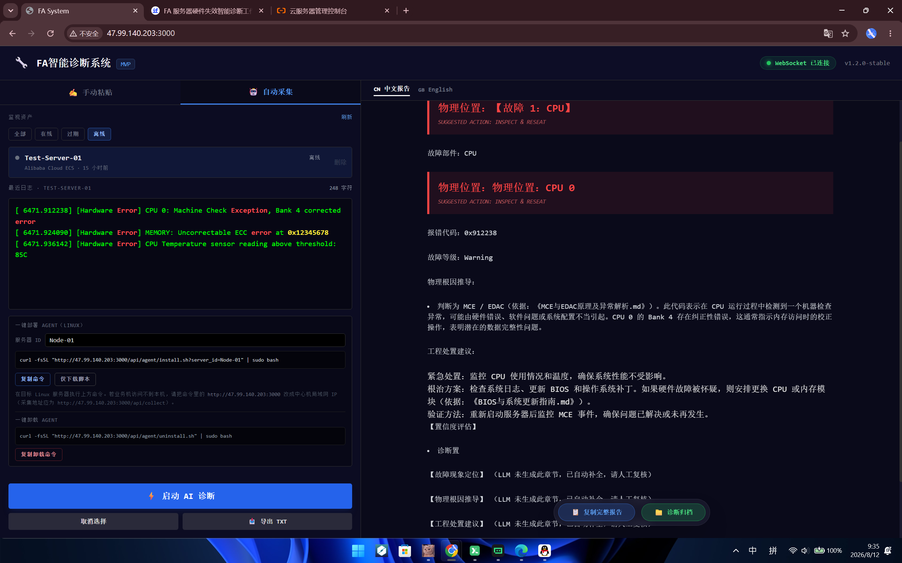
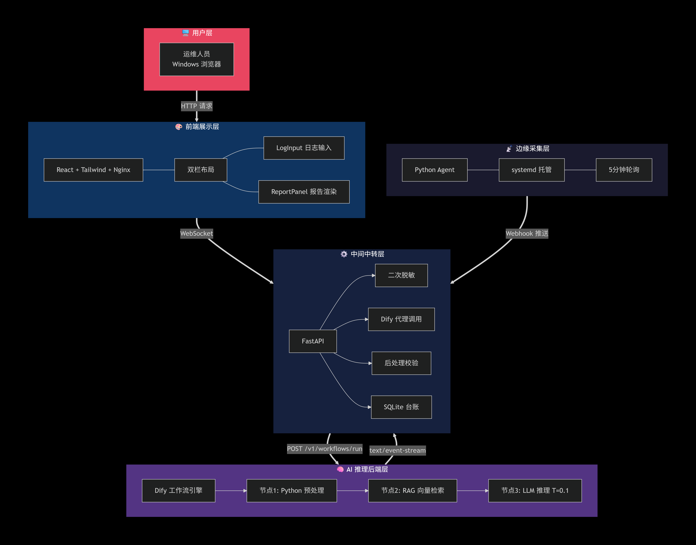

<div align="center">

# FA 智能诊断系统
### FA Hardware Fault Diagnosis System

**让服务器硬件故障分析更清晰、更可追溯。**

面向 x86 Linux 服务器的自部署诊断平台。提交系统日志，结合 Dify 工作流和硬件故障知识库，生成结构化分析报告，辅助运维人员定位问题与制定处置步骤。


[功能介绍](#项目概览) · [快速开始](#快速开始) · [架构设计](docs/架构设计.md) · [部署手册](docs/离线部署手册.md) · [English](#english)

</div>

---

## 产品演示

<p align="center">
  
</p>

<p align="center">
  
</p>

## 项目概览

FA 将日志输入、知识检索、模型分析和报告展示整合在一套可自部署的平台中，适用于在线模型服务或内网本地模型环境。

| 能力 | 说明 |
| --- | --- |
| 日志输入 | 支持人工粘贴，也可部署 Python Agent 采集日志 |
| 故障分析 | 使用 Dify 工作流结合硬件故障知识库进行分析 |
| 结构化报告 | 按故障定位、根因推导、处置建议和置信度组织结果 |
| 流式展示 | 通过 WebSocket 将诊断过程逐步显示在前端 |
| 部署选择 | Docker Compose；支持在线模型和离线本地模型部署 |

### 主要功能

- **故障定位辅助**：提取硬件类型、错误码和日志中可识别的插槽信息。
- **知识库检索**：将相关资料用于分析，并提示依据和不确定项。
- **日志脱敏**：后端对提交的日志执行基础脱敏处理。
- **内网运行**：支持在内网环境运行 Dify、向量数据库和本地模型。

> 诊断结果用于辅助分析，不能替代现场检查或硬件厂商的维修规范。部署前请评估日志数据和模型服务的隐私要求。

## 系统架构



```text
服务器日志 / 运维人员
        │
        ▼
React 前端 ── WebSocket ── FastAPI 后端
                              │
                              ▼
                      Dify 工作流与知识库
                              │
                              ▼
                    在线模型或 Ollama 本地模型
```

架构分层、数据流和容器说明见[架构设计](docs/架构设计.md)。

## 快速开始

### 在线部署

适用于服务器可以访问镜像仓库、并计划使用在线模型服务的场景：

```bash
git clone https://github.com/2317715129p-droid/fa-diagnosis-platform.git
cd fa-diagnosis-platform
sudo bash deploy/install-public.sh
```

部署后可访问：

- FA 前端：<code>http://&lt;服务器IP&gt;:3000</code>
- Dify 控制台：<code>http://&lt;服务器IP&gt;:80</code>
- 后端健康检查：<code>http://&lt;服务器IP&gt;:8000/health</code>

首次启动后，请按部署手册完成 Dify 管理员、模型服务和工作流配置。公网部署时不要保留默认密码或示例密钥。

### 离线部署

离线部署需单独准备 Docker 镜像和本地模型文件；大体积运行包不纳入源码仓库。环境要求和部署步骤见[离线部署手册](docs/离线部署手册.md)。离线包发布信息将在可用渠道确认后更新到项目页面。

### 本地开发

运行前请准备 Python、Node.js 和可访问的 Dify 工作流：

- 后端依赖：[backend/requirements.txt](backend/requirements.txt)
- 前端工程：[frontend/](frontend/)
- 工作流与知识库：[dify/workflow/](dify/workflow/) · [dify/knowledge-base/](dify/knowledge-base/)

## 诊断报告

报告按四个部分组织：

1. **故障现象定位**：部件、位置和日志错误码（若可识别）。
2. **物理根因推导**：结合知识库检索结果进行分析。
3. **工程处置建议**：建议的检查、维修和验证步骤。
4. **置信度评估**：说明诊断依据及仍需人工确认的内容。

报告格式规范见 [FA 报告写作规范](dify/knowledge-base/FA报告写作规范.md)。

## 项目文档

- [架构设计](docs/架构设计.md) — 系统分层、数据流与容器部署
- [离线部署手册](docs/离线部署手册.md) — 内网部署流程与环境准备
- [综合技术报告](docs/技术报告.md) — 项目背景、功能和技术方案
- [部署与测试报告](docs/部署与测试报告.md) — 部署记录与测试用例
- [知识库与防幻觉机制](docs/知识库与防幻觉机制.md) — 检索知识库与报告校验设计
- [部署问题记录](docs/部署Bug修复记录.md) — 部署问题及处理记录

## 技术栈

**前端**：React · Vite · Tailwind CSS  
**后端**：Python · FastAPI · SQLite  
**工作流与检索**：Dify · Weaviate  
**模型**：在线模型服务或 Ollama 本地模型  
**部署**：Docker Compose · Nginx

## 许可证

本项目使用 MIT License，详见 [LICENSE](LICENSE)。Dify 及其他依赖组件遵循各自的许可证。

---

## English

FA is a self-hosted hardware fault diagnosis platform for **x86 Linux servers**. It combines system logs, a Dify workflow, and a hardware knowledge base to produce structured reports for operations teams.

### Features

- Manual log submission and optional Python Agent collection
- Knowledge-based analysis with structured reports
- Streaming output through WebSocket
- Basic log masking in the backend
- Online model services or an offline deployment with Ollama

### Quick start

```bash
git clone https://github.com/2317715129p-droid/fa-diagnosis-platform.git
cd fa-diagnosis-platform
sudo bash deploy/install-public.sh
```

See the [offline deployment guide](docs/离线部署手册.md) and [architecture document](docs/架构设计.md) for more details.

Diagnosis output assists investigation and should be checked against vendor guidance and on-site evidence. Large offline deployment images are not stored in the source repository; distribution details will be added when an available channel is confirmed.

## License

MIT License. See [LICENSE](LICENSE). Third-party components retain their respective licenses.
